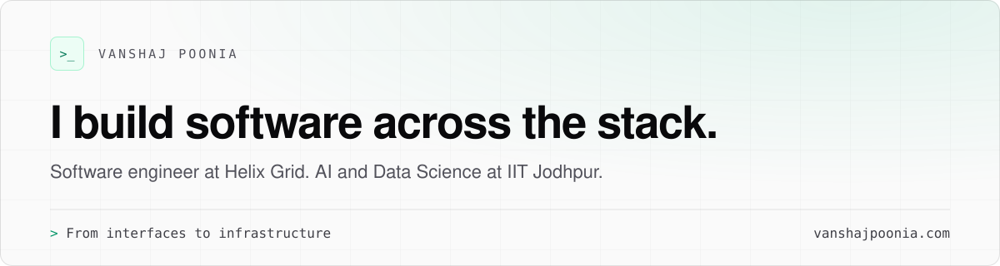

<picture>
  <source media="(prefers-color-scheme: dark)" srcset="assets/banner-dark.svg">
  
</picture>

  
  
  
  
  
  

Hi, I'm Vanshaj. I build full-stack products and AI tools, and I'm writing a small operating system in Rust to learn what sits underneath them.

- Software engineer at **Helix Grid** (part-time), working on LLM features
- Studying **AI and Data Science at IIT Jodhpur**
- Contributing to open source since Hacktoberfest 2021, lately in **AOSSIE PictoPy**, **ClickHouse Loom** and **OpenWISP**
- Off the keyboard, I play guitar

## Things I've built

| Project | What it does |
| --- | --- |
| [**ChronoOS**](https://github.com/VanshajPoonia/chronosapien) Rust · no_std · x86_64 | A hobby operating system. It boots under QEMU, draws its own console and gives you a shell. I wrote it to learn boot, memory, interrupts and filesystems. |
| [**TensorTrail**](https://github.com/VanshajPoonia/TensorTrail) Python · NumPy | A neural network framework built from the autograd up. Convolutions, optimisers and a trainer, kept honest by 137 tests and a gradient checker. |
| [**Already Filed**](https://github.com/VanshajPoonia/already-filed) EmbeddingGemma · WebGPU | Finds open GitHub issues that repeat an earlier report. The model runs in your browser tab. On zed it put the duplicate maintainers linked in its top three 65% of the time. Keyword search got 38%. [Try it](https://vanshajpoonia.github.io/already-filed/) |
| [**Big Brother**](https://github.com/VanshajPoonia/big-brother) Python · Docker · Ollama | A GitHub bot that runs a bug report's code in an offline sandbox and labels the issue from what actually happens. Built overnight at a hackathon with three teammates. |
| [**ASCII Camera**](https://github.com/VanshajPoonia/asciicamera) TypeScript · Canvas | Your webcam as live ASCII art at 60fps, right in the browser. [Try it](https://asciicam.vanshajpoonia.com) |
| [**Open models in the browser**](https://vanshajpoonia.com/work/open-model-browser-apps) transformers.js · WebGPU | Seven small apps from Hacktoberfest's AI challenges. Whisper, CLIP, Gemma 3 and Kokoro run inside the tab, so nothing gets uploaded. |

More on [vanshajpoonia.com/work](https://vanshajpoonia.com/work).

### Languages and Tools:

